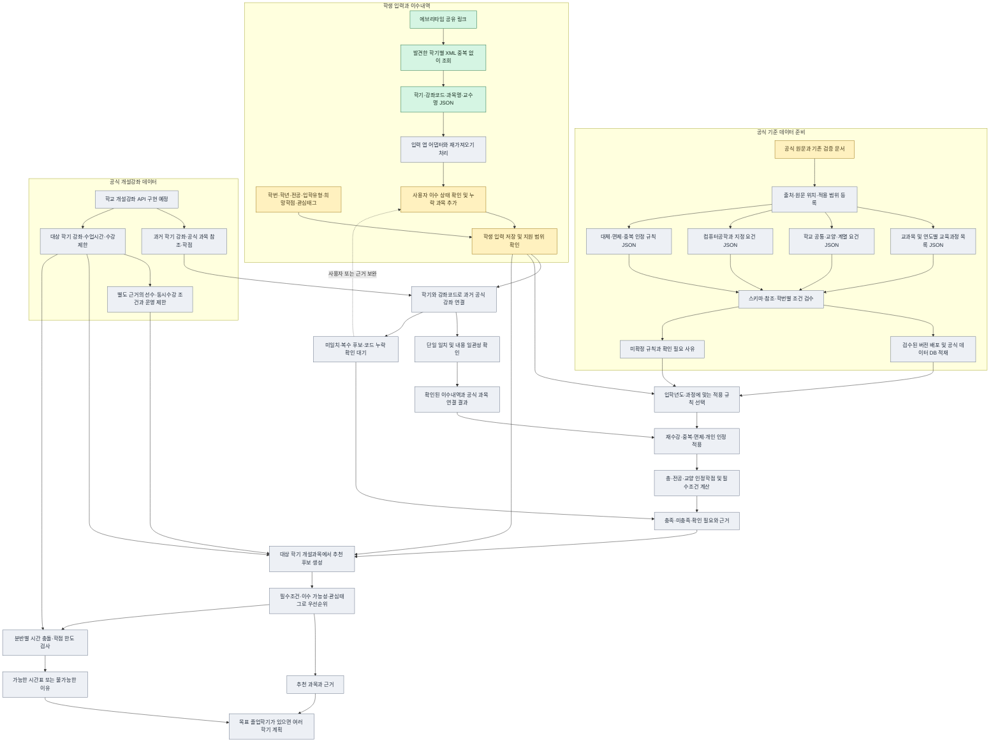

# 수강 추천·수강 계획 개발 설계와 상세 파이프라인

공유 링크는 [입력 앱](../intake_app/README.md)에서 가져와 검토할 수 있다. 학생이 이수 완료로 확인한 과목은 공식 개설강좌 DB에서 대조한다. 구현 범위와 실링크 검증 결과는 [CPG 작업 기록](../cpg/04-decisions-and-work.md)에서 관리한다.

정리일: 2026-11-12  
기준 문서: [컴퓨터공학과 교과 이수요건](<graduation_requirements.md>)

## 1. 기능 범위

학번과 이수내역을 바탕으로 필요한 과목을 추천하고, 목표 학기까지의 수강 계획을 구성한다. 결과는 ‘교과 이수요건 충족 예상’으로 표시한다. 전체 졸업 가능 여부를 판정하는 기능은 현재 범위에 포함하지 않는다.

## 2. 규칙·데이터 구분

아래는 공식 규정을 바탕으로 한 **구현 제안**이며 학교의 별도 규정 문구가 아니다.

| 데이터·판정 | 필요한 구분 |
|---|---|
| 학생 적용 범위 | 입학년도, 입학경로, 학과·계열, 현재 지원 범위 해당 여부 |
| 시간 기준 | 입학년도 / 실제 수강학기 / 추천 대상 학기 / 목표 졸업학기를 각각 관리한다. 현재 입력의 `target_term`은 추천 대상 학기다. |
| 정규학기 수 | 실제 이수한 정규학기 수는 학적 기록이나 학생 확인을 통해 확보한다. |
| 규칙 소속 | 학교 공통 / 학교 계열별 / 학과 고유 / 학생 개인 예외 |
| 과목 조건 | 반드시 이수 / 택1 충족 / 영역별 충족 / 지정 과목군 학점 합계 |
| 학점 | 성적표 취득학점 / 졸업 인정학점 / 전공 인정학점 / 교양 인정학점 |
| 대체·중복 | 필수조건 대체 가능 여부와 중복 학점 인정 여부를 별도 저장 |
| 결과 상태 | 충족 / 미충족 / 확인 필요. 자료가 없다는 이유로 면제 처리하지 않음 |
| 근거 | 원문 URL, 원문 연도·게시일, 확인일, 적용 대상, PDF 쪽수, 상충 내용 |

## 3. 추천·계획 계산에서 유지할 사항

- 학교 공통·계열별 기준과 컴퓨터공학과 지정 기준을 각각 적용한다.
- 필수 과목 충족, 영역별 충족, 전공·교양·총 인정학점을 별도로 계산한다. 각 학점의 포함 관계를 반영한다.
- ‘택1 필수 충족’과 ‘두 과목의 학점 중복 인정’을 분리한다.
- 기존 이수 완료, 현재 수강 중, 향후 계획 과목을 구분한다. 계획 과목의 학점을 이미 취득한 학점처럼 표시하지 않는다.
- 폐설·대체·면제와 타학과 학점 인정 예외를 적용한 뒤 남은 과목·학점을 계산한다.
- 정규학기 8개 기준은 확인된 이수학기 수로 판단한다. 공유 시간표에서 찾은 학기 수는 시간표 수집 범위를 나타낸다. 이수학기 수를 확인하지 못하면 학기 기준은 ‘확인 필요’로 표시한다.
- 여러 학기에 걸친 계획에서는 목표 졸업학기를 기준으로 성적 반영 시점과 동시 수강 조건을 확인한다.
- 미확정 인정 관계가 있는 경우 확인 필요 사유를 표시한다.

## 4. 별도로 수집·검증할 운영 데이터

실제 개설학기·분반·수업시간, 선수과목, 학년·학과별 수강제한, 수강학점 한도 및 예외가 필요하다. 이 목록은 구현을 위한 수집 항목이며, 각 제한의 실제 값이 이미 검증됐다는 의미는 아니다.

캡스톤디자인의 작품 제출 등 과목 이수조건은 해당 학기의 강의계획서와 학과 공지에서 확인한다. [컴퓨터공학과 수강 안내](https://computer.seoultech.ac.kr/info/notice?allboard=false&bidx=777449&bnum=58476&cate=7&do=view&nowpage=1&profboardidx=0)

## 5. DB보다 먼저 할 일

**공식 데이터를 구조화하기 위해 DB를 먼저 만들 필요는 없다.** 먼저 데이터 구조와 검증 기준을 정하고, 공식 자료를 출처가 있는 JSON으로 변환·검수한다. 그다음 검수된 데이터를 SQLite에 적재하고 앱에서 조회한다. JSON과 DB에 각각 규칙을 수작업으로 입력하지 않고, 버전이 있는 JSON 묶음을 기준으로 DB를 재생성할 수 있게 한다.

현재 `intake_app/store.py`에는 SQLite 저장 기능이 있다. 다만 `student_input` 한 행의 `document_json`에 학생 입력 문서 전체를 저장하는 구조이며, 공식 과목·학번별 요건을 조회하는 DB는 아니다. 공식 데이터 저장소를 추가할 때 기존 학생 데이터를 보존하는 마이그레이션이 필요하다. 초기 로컬 개발은 SQLite로 이어갈 수 있으며, 별도 DB 서버 도입은 구조화의 선행 조건이 아니다.

권장 개발 순서: **스키마 정의 → 공식 데이터 JSON 작성 → 근거·참조·규칙 검수 → 버전 확정 → DB 적재 → 계산·조회 기능 연결**.

아래 내용은 2026-11-12의 프로젝트 코드·문서를 기준으로 작성한 설계다. 새로운 공식 규정 검증이나 공식 개설과목 API 구현을 완료했다는 뜻은 아니다.

## 6. 현재 구현 상태

| 구성 요소 | 현재 상태 | 다음 작업 |
|---|---|---|
| 교과 이수요건 문서 | 학교 공통·계열 기준과 학과 기준을 구분한 문서 및 검증 부록 존재 | 2021~2026 적용 범위와 출처를 가진 구조화 데이터로 변환 |
| 미확정 조건 | `review_notes.md`에서 관리 | 미확정 상태와 영향을 받는 규칙을 데이터에 표현 |
| 에타 공유 링크 수집 | XML 조회·학기 탐색·중복 조회 방지·입력 앱 미리보기 | 자료 누락 사례 검수 |
| 실링크 수집 검증 | 첫 링크 10개 시간표·34과목, 두 번째 링크 10개 시간표·27과목. 두 결과 모두 조회 실패 0건, 강좌코드 누락 경고 각 1건 | 다양한 실패·누락 사례는 기존 단위 테스트와 함께 유지 |
| 학생 입력 앱 | v2 입력, 에타 선택 적용, 직접 입력, 이수 확인·SQLite 저장 | CPG 공통 API 통합 |
| 공식 과목 목록·학번별 요건 JSON/DB | 미구현 | 다음 개발 대상 |
| 과거·대상 학기 공식 개설강좌 수집 | 2021~2026년 정규·계절학기 24개 분반 스냅샷 확보 | 추천 대상 학기 갱신 및 수강제한 자료 검수 |
| 에타 과목과 공식 강좌 연결 | 확인된 이수과목의 공식 분반 대조 | 교육과정의 과목 ID와 연결 |
| 인정학점·미충족 요건 계산 | 미구현 | 적용 규칙과 연결·이수 확인 데이터가 갖춰진 뒤 구현 |
| 추천·시간표·여러 학기 계획 | 미구현 | 계산 결과와 대상 학기 운영 자료를 기반으로 단계적으로 구현 |

입력 앱은 에타 수집 행을 학생 입력 v2로 변환한다. 원본 시간표·과목 식별자는 재수집 비교용 해시로 변환하고, 사용자가 선택한 추가·갱신만 반영한다.

## 7. 전체 파이프라인

실선은 데이터 흐름, 점선은 확인 결과의 재입력이다. 녹색은 구현 완료, 노란색은 일부 구현·검증, 회색은 앞으로 구현할 단계다. 에타 수집부터 시작하는 흐름에 공식 데이터 준비 흐름과 대상 학기 운영 자료 흐름을 별도로 연결한다.

기존 그림의 ‘학기·강좌·수업 일정 정리’는 과거 이수내역에서는 **학기·강좌 최소정보 정리**로 바꾼다. 시간·요일·강의실은 과거 이수 확인에 저장하지 않는다. 앞으로 수강할 대상 학기의 시간표를 만들 때는 공식 개설강좌의 수업 일정이 필요하다.

## 8. 공식 데이터의 구조와 검수

아래 이름은 제안하는 JSON 묶음과 논리적 테이블 이름이다. 아직 실제 파일·테이블을 만든 것은 아니다. 단순 명칭 목록으로 저장하지 않고, 과목 자체·연도별 교육과정·학기별 강좌를 분리한다.

| 데이터 | 핵심 필드·관계 | 역할 |
|---|---|---|
| `sources` | `source_id`, 공식 URL, 제목, 발행/교육과정 연도, 확인일, PDF 파일 쪽수·인쇄면, 보관 원문 해시 | 각 데이터와 규칙의 근거 추적. 값의 근거가 되는 쪽수는 규칙별 참조에서도 지정 |
| `courses` | 내부 `course_id`, 공식 과목코드 문자열, 기본 과목명 | 과목의 식별. 강좌코드와 구분하며 코드 변경·재사용은 근거로 판단 |
| `curriculum_courses` | `course_id`, 교육과정 연도, 학과/계열, 당시 명칭·학점·이수구분·영역, `source_refs` | 같은 과목의 연도별 정보를 보존. 교육과정 연도와 학생 입학연도 적용을 동일시하지 않음 |
| `requirement_sets` | `requirement_set_id`, 입학연도, 학과/계열, 입학유형·과정·전공유형, `rule_ids`, 버전 | 어떤 학생에게 어떤 규칙 묶음을 적용하는지 지정 |
| `requirement_rules` | `rule_id`, `scope`, 조건 종류, 대상 과목군, 기준값, 적용 대상·시점, `source_refs`, 검증 상태 | 학교 공통/교양/계열/학과 기준을 독립 관리하고 학생별로 조합 |
| `course_groups` / `course_group_members` | 그룹 ID, 멤버 `course_id`, 적용 학번·시점, 출처 | 택1, 학점 합계, 영역별 후보 목록. 현재 목록을 과거 학번에 자동 소급하지 않음 |
| `recognition_rules` | 조건, 대체 조합·면제·학점 제외·상한·중복 인정 정책, 적용 범위, 출처·검증 상태 | 필수 이수 충족 여부와 실제 인정학점 계산을 분리 |
| `course_offerings` / `offering_meetings` | `offering_id`, 학기, 전체 강좌코드, `course_id`, 교수, 당시 학점·운영 정보 / 일정 배열 | 추후 API로 채움. 과거 연결과 대상 학기 추천의 기반 |
| `dataset_manifest` | 스키마 버전, 데이터 버전, 포함 학번·과정, 파일 목록·해시, 검수 결과 | 검수한 묶음 단위로 적재·재현·변경 추적 |

규칙의 `scope` 예시는 `university_common`, `university_general_education`, `university_track`, `department`다. 공지를 올린 부서가 아니라 실제 규칙 적용 범위를 기준으로 분류한다. 개인별 승인 예외는 학생 데이터에 별도로 연결한다.

규칙 종류는 최소한 다음을 표현해야 한다.

- `min_credits`: 전체·전공·교양 또는 지정 과목군의 최소 인정학점.
- `required_course`: 지정 과목 이수.
- `choose_n`: 지정 과목군에서 정해진 수 이상의 조건 충족.
- `all_of`: 하위 조건을 모두 충족. 영역별 필수를 하나의 합산 학점으로 대체하지 않음.
- 인정 정책: 대체 과목의 조합, 면제, 학점 제외·상한, 재수강·중복 인정. 필수 충족과 학점 인정에 서로 다른 영향을 줄 수 있음.

규칙을 저장할 때 필수·권고를 구분한다. 권장 조합은 추천 우선순위의 근거가 될 수 있지만 필수 미이수 판정의 근거가 되어서는 안 된다. `verified`, `pending`, `conflicting` 같은 검증 상태와 자동 계산 사용 여부를 별도 관리하며, 미확정 규칙을 제거하거나 기본값으로 확정하지 않는다.

검수는 다음 순서로 한다.

1. 필수 필드·자료형·고유 ID·외래 참조를 검사한다. 공식 코드의 앞자리 0을 보존한다.
2. 2021~2026 각 학번의 규칙 묶음과 지원 범위를 확인한다. 편입 등의 미지원 범위를 신입학 규칙에 자동 대입하지 않는다.
3. 원문과 과목 목록·학점·영역·택1 조건을 대조한다. 본문에 인용된 일부 필수과목만으로 전체 공식 과목 목록이 완성되었다고 표시하지 않는다.
4. 출처, 적용 시점, 대체 및 중복 인정 조건을 확인한다. 미확정 쟁점은 `review_notes.md`와 연결한다.
5. 작은 가상 이수내역으로 조건별 기대 결과를 검사한다. 택1 두 과목 이수, 영역 누락, 학점 제외, 면제, 미확정 대체, 과거 학번 소급 적용 금지 등을 포함한다.
6. 검수된 데이터 버전을 확정하고 하나의 트랜잭션으로 DB에 적재한다. 실패하면 이전 버전을 유지하고 학생 입력 데이터는 덮어쓰지 않는다.

## 9. 학생 입력부터 공식 연결 직전까지

| 단계 | 입력 | 처리·출력 | 다음 단계로 넘길 조건 |
|---|---|---|---|
| 공유 링크 수집 — 구현됨 | 에타 공유 URL | 식별자 추출, 학기 탐색, XML 파싱, 독립 수집 JSON | 수집 상태와 실패·경고를 함께 전달 |
| 입력 어댑터 — 구현됨 | 수집 JSON + 기존 입력 문서 | v2 변환, 강좌코드·교수와 재수집용 출처 해시 저장 | 기존 수동 내역 및 사용자 확인 결과를 유지 |
| 재가져오기 — 구현됨 | 기존 행과 새 수집 행 | 해시로 비교해 추가·변경 내역 제시 | 사용자 수락 후 변경 반영. 원본 ID가 없는 행은 변경 시 검토 |
| 사용자 확인 — 일부 구현 | 수집/수동 과목 | 이수 완료·수강 중·미이수 구분, 누락 과목 추가, 전체 내역 여부 확인 | 각 과목의 확인 상태를 보존. 일부 미확인으로 전체 입력을 잃지 않음 |
| 프로필 검증 — 일부 구현 | 학생 공통 입력 | 적용 범위와 희망 학점, 추천 대상 학기를 검증 | 지원 범위 밖이면 별도 검토 상태 |

학생 공통 입력은 기존 `department_id`, `admission_year`, `grade`, `admission_type`, `target_term`, `min_credits`, `max_credits`, `interests`를 유지한다. 희망 학점 범위는 학교의 실제 수강 한도와 다른 값이며, 기존 앱의 입력 검증 상한을 학교 규정으로 사용하지 않는다. 여러 학기 계획을 요청하는 경우에만 `graduation_target_term`을 추가한다. 실제 이수한 정규학기 수는 별도 확인값으로 관리한다.

이수 상태 확인, 공식 과목 연결, 학점 인정은 서로 다른 판단이다. 사용자가 이수 완료라고 확인해도 아직 공식 과목에 연결되지 않은 행이 있을 수 있고, 연결되었어도 졸업학점에서 제외되는 과목일 수 있다. 편입 인정 총학점만으로 개별 필수과목 면제·전공 인정 여부를 추론하지 않는다.

## 10. 공식 연결·인정 계산·추천의 상세 처리

### 10.1 과거 공식 분반 대조

1. 확인된 이수 완료 과목에서 학기와 `6자리 과목코드-5자리 분반번호` 형식을 사용해 학교 스냅샷을 조회한다. 실링크 2개에서 코드가 있는 59건의 과목명과 교수명을 대조했다.
2. 후보가 하나이고 과목명·교수 정보에 충돌이 없으면 `offering_id`와 스냅샷 정보를 반환한다. 교육과정 `course_id`의 연결은 공식 과목 데이터가 준비된 후 진행한다.
3. 코드 누락·후보 없음·복수 후보·정보 충돌이면 확인 대기로 남긴다. 과목명·교수명은 후보 확인에 사용할 수 있지만 이름 유사도만으로 확정하지 않는다.
4. 과거 학기 API 자료가 없으면 현재 개설강좌로 대체해 확정하지 않는다. 추가 공식 자료나 수동 검증 경로를 마련한다.

분반 대조는 별도 `offering_comparison` 결과에 수강내역 ID·분반 ID·스냅샷·개설 학점을 담는다. 학생 문서와 비교에 사용한 공식 자료는 각각 원래 입력과 조회 근거를 유지한다.

### 10.2 교과 이수요건 계산

1. 입학년도·학과·과정에 맞는 학교 공통, 학교 교양·계열, 학과 규칙을 선택한다.
2. 확인된 이수 완료 과목과 승인된 개인별 예외를 기준으로 인정 내역을 만든다. 현재 수강 중·계획 과목의 예상 결과는 따로 계산한다.
3. 재수강·중복·상한·제외·면제를 반영한다. 과목의 표시 학점과 학생에게 실제 인정되는 학점을 구분하고, 필요하면 성적표·공식 승인 등 추가 근거를 요청한다.
4. 전공필수 학점은 전공학점에, 전공·교양 인정학점은 총학점에 포함되는 관계를 반영한다. 같은 이수 과목이 여러 집계에 포함되는 것과 배타적인 두 필수 그룹을 동시에 충족하는 것은 다르므로 규칙별 허용 여부를 명시한다.
5. 규칙별 충족/미충족/확인 필요와 사용한 과목·인정학점·출처를 출력한다. 불완전한 이력이나 연결 실패 때문에 결과가 달라질 수 있으면 미충족으로 단정하지 않는다. 이미 충분한 근거로 충족한 조건까지 일괄 확인 필요로 바꾸지 않는다.

계산 결과에는 입력 버전과 공식 데이터 버전을 남긴다. 사용자 화면에서는 ‘교과 이수요건 충족 예상’으로 설명하며, EPiC 및 비학점 졸업 행정요건은 계산 범위에 넣지 않는다.

### 10.3 추천과 시간표 계획

1. **후보 생성:** 대상 학기에 실제 개설된 강좌를 가져와 이미 인정된 과목, 중복 이수 불가 과목 등을 검토한다.
2. **이수 가능성:** 학과·학년 제한, 선수·동시수강 조건, 학점 한도 등을 적용한다. 해당 정보가 없으면 ‘제한 없음’으로 간주하지 않고 확인 필요를 표시한다.
3. **우선순위:** 남은 필수조건, 이후 과목의 선행 조건, 졸업 목표와 개설 주기, 관심 태그 순으로 설명 가능한 기준을 정한다. 우선순위의 구체적 가중치는 추후 결정한다.
4. **시간표 조합:** 과목별 분반의 모든 수업 일정을 이용해 시간 충돌과 희망/허용 학점 범위를 검사한다. 수업 일정 누락 강좌가 포함된 결과는 충돌 없는 확정 시간표로 표시하지 않는다.
5. **결과:** 추천 과목, 해당 과목이 해결하는 요건, 선택한 분반, 예상 인정학점, 남은 조건, 확인 필요 항목을 출력한다. 가능한 조합이 없으면 어떤 제약 때문에 불가능한지 설명한다.
6. **여러 학기 계획:** 목표 졸업학기가 있을 때 확장한다. 미래 개설이 미확정이면 과거 개설 패턴을 이용한 가정임을 표시하고, 실제 개설 확정 후 다시 계산한다. 성적 반영 시점도 반영한다.

## 11. 다음 개발 단위와 완료 기준

| 순서 | 작업 | 완료 기준 |
|---|---|---|
| 1 | 공식 데이터 JSON 스키마·ID·검증 상태·출처 구조 정의 | 학교/학과 규칙, 과목/강좌, 입학연도/교육과정 연도/수강학기 구분이 표현됨 |
| 2 | 2021~2026 공식 과목 목록과 학번별 요건 변환 | 학번별 원문 목록 대조, 출처 참조, 미확정 조건 분리. 필수 이외 과목 목록의 수집 범위도 명시 |
| 3 | 정적 검수 및 규칙 예시 검증 | 필수값·ID·참조·학번 범위·택1·영역·중복 계산 사례 통과 |
| 4 | 공식 데이터 SQLite 적재·조회 | 같은 JSON 버전으로 재생성 가능, 기존 학생 입력 보존 |
| 5 | 에타 JSON 입력 앱 연동 | 가져오기·검토·재가져오기 시 확인 결과 보존, 불필요한 과거 일정 입력 정리 |
| 6 | 공식 개설강좌 API | 과거/대상 학기 지원 범위·코드·학점·시간·제한의 실제 제공 여부 확인 |
| 7 | 과거 강좌 연결 및 인정 계산 | 정확한 연결·확인 대기 분리, 계산 근거 추적, 미완전 이력 처리 |
| 8 | 한 학기 추천 → 시간표 → 여러 학기 계획 | 추천 근거, 제약 검사, 불가능/미확정 상태를 설명 |

현재 바로 착수할 대상은 **1~3의 공식 데이터 구조화와 검수**다. 5의 입력 앱 연동은 공식 연결 없이도 별도로 진행할 수 있다. 이 문서 작성으로 DB·API·과목 연결 또는 추천 기능을 구현한 것은 아니다.

## 12. 이번 변경의 범위

이전 파이프라인 이미지를 바탕으로 상세 설계만 확장했다. 공식 원문 검증 기록과 미확정 쟁점은 기존 본문·검증 부록·검수 메모를 참조한다. 기존 입력 앱, 에타 수집 모듈, 실제 사용자 JSON은 수정하지 않았다.
